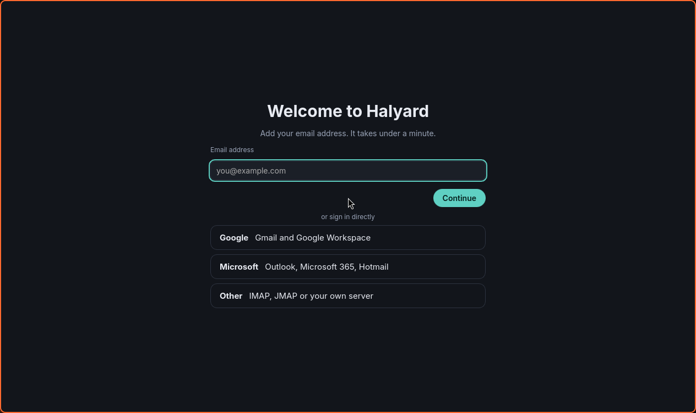
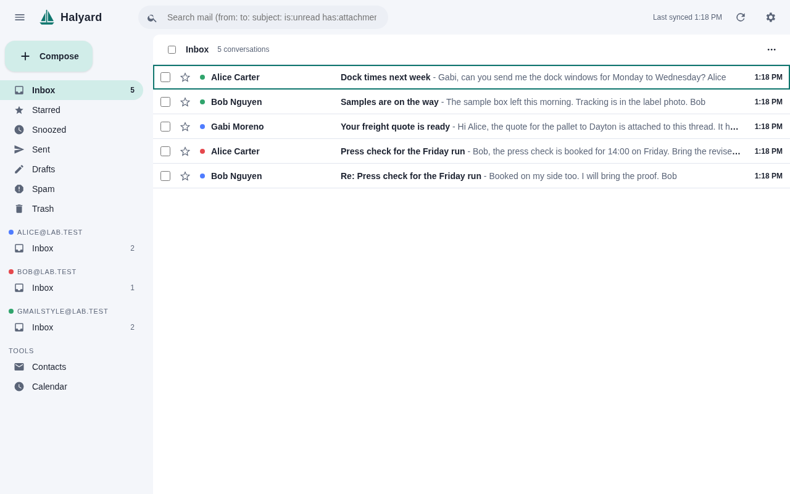
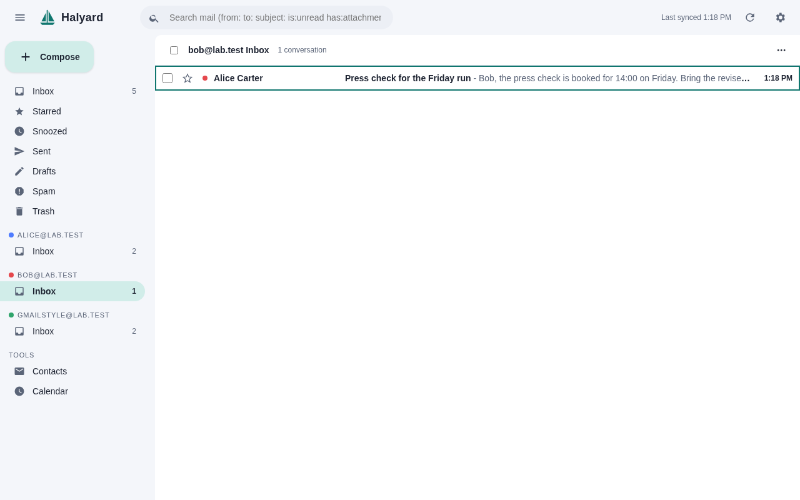
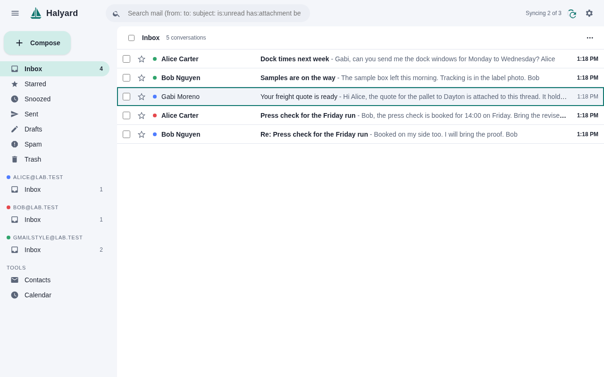
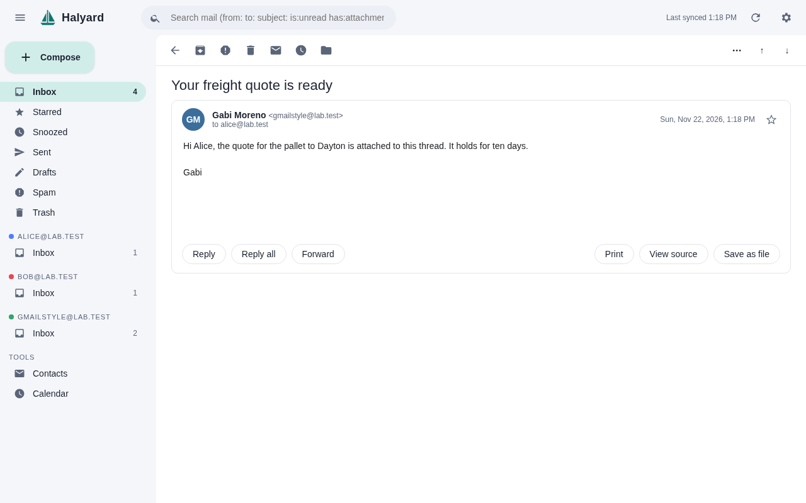
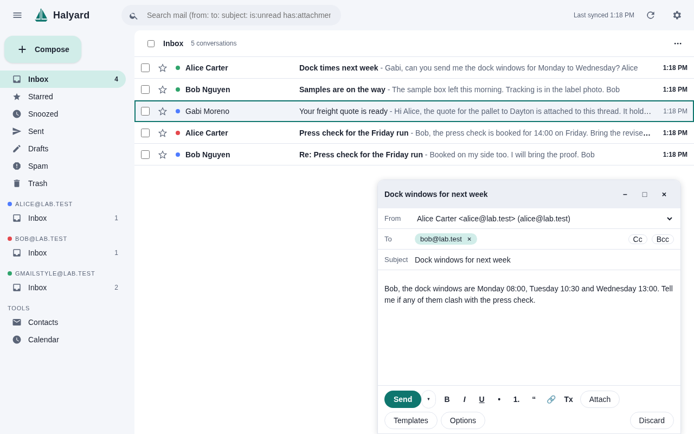

# Halyard

Email that does its job and gets out of the way.

Halyard is as quick and clear as Gmail on the web, and it works with the mail you already have. Google, Microsoft 365, Outlook.com, or a server you run yourself, all in one window. Your mail lives on your machine, not in somebody else's data mill. Linux and Windows.

Type your address. Halyard finds the provider and walks you through signing in, and your mail is there. Under a minute, and no settings page standing in the way.

## Every account, one inbox

Work, personal, the shared box the whole shop uses. Add as many as you like, Gmail, Microsoft and IMAP side by side. One combined inbox shows everything that needs you, and one click on an account narrows the list to just that one. Each account keeps its own color, so you always know where a message came from and which address you answer from.

## Sync now, and know it worked

One button refreshes every account at once. It shows how far along it is, and when it is done it tells you exactly when your mail was last brought up to date. No guessing whether the message you are waiting on is stuck.

## Read fast, write faster

Conversations stay together. Search takes operators (`from:` `to:` `subject:` `filename:` `label:` `is:` `has:` `before:` `after:` `larger:` `smaller:` and more) and you can save the searches you run every day. Snooze what can wait, unsubscribe from lists in one click, answer calendar invitations without leaving the message.

Writing is just as quick. Rich text, attachments by drop or paste, drafts kept on the server, undo send, schedule for later, templates, signatures per identity, spell check, and OpenPGP or S/MIME when the message has to be private.

## What you get

* **Accounts:** Gmail and Google Workspace (Gmail API, or IMAP with an app password), Microsoft 365 and Outlook.com (Graph, one click sign in), IMAP and SMTP, POP3, and JMAP. Several at once, one combined inbox.
* **Reading:** conversations, full text search, saved searches, snooze, labels and folders, calendar invitations you can answer, unsubscribe from mailing lists, read receipts, print, view source, save as .eml or mbox.
* **Writing:** rich text, attachments by drop and paste, drafts kept on the server, undo send, schedule for later, templates, several identities and signatures, spell check, sign and encrypt with OpenPGP or S/MIME.
* **Organizing:** filters that run on new mail, server side Sieve filters (ManageSieve), vacation replies kept on the server, folders you can rename and delete, mark all read, empty trash.
* **Contacts and calendar:** an address book and calendars from any CardDAV and CalDAV server.
* **Moving in:** import mbox files and Thunderbird profiles, so your old mail comes with you.
* **Everywhere:** a command palette and keyboard shortcuts you can change, light and dark themes, an icon in the notification area, desktop notifications, an offline cache that replays your changes when the network comes back, English and thirteen other languages.
* **Automation:** the `halyard` command line (send, search, list, read and the rest) and a built in MCP server that reads and writes every account. See `docs/MCP.md`.

## Install

* **Windows:** run `halyard-<version>-setup.exe` from the release page. The installer is signed.
* **Arch Linux and EmberArch:** `pacman -U halyard-<version>-1-x86_64.pkg.tar.zst`.
* **EmberRTOS Desktop:** `zypper install halyard`.
* **openSUSE and other rpm systems:** `zypper install ./halyard-<version>-0.x86_64.rpm` from the release page.

Open it from your application menu, or start it with `halyard`. On Linux, updates come from your package manager. On Windows, Halyard tells you when a newer release is out and checks the installer before you run it.

## Build and test

    go build ./... && go test ./...
    lab/stalwart.sh up          # a local mail server for the live tests; needs Podman
    MAIL_LAB_HOST=127.0.0.1 go test ./internal/e2e -run 'Lab|TestFeat'
    node ui/test/smoke.mjs <demo build of halyardd>    # go build -tags demo ./cmd/halyardd
    node ui/test/multi_sync.mjs <halyardd>             # three accounts at once and Sync now, against the lab

`tools/completeness.sh` runs all of it and checks it against the maintainer's feature list.

## Layout

`cmd/halyard` the window and the command line, `cmd/halyardd` the headless daemon, `cmd/halyardctl` the command line alone, `internal/` the core (`plugin` and `providers` for each kind of account, `store`, `engine`, `api`, `mcpserver`, `secure`, `sieve`, `dav`, `ical`, `rules`, `oauth`, `discover`), `ui/web` the front end and its translations, `packaging` the three builds, `lab` the local mail server, `design` the art.

## How the window is built

The window is Wails v2: one library gives a window, a single instance lock and the platform webview (WebKitGTK on Linux, WebView2 on Windows). The front end reaches the Go core through the asset handler inside the same process, so no network port needs protecting. The same front end runs in a plain browser against `cmd/halyardd`, which is how it is tested.

## Release

Builds: `packaging/build.sh <version> arch|rpm|windows <dir>`. See `RELEASE_CHECKLIST.md`.

## License

See `LICENSE`.
